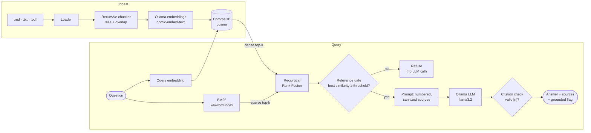

# 🔒 local-rag-kit

**Private, fully local retrieval-augmented generation.** Ask questions over your own documents. Nothing leaves your machine: [Ollama](https://ollama.com) runs the models, [ChromaDB](https://www.trychroma.com) stores the vectors, and [FastAPI](https://fastapi.tiangolo.com) serves the API.

It's built around what usually goes wrong in RAG systems: wrong chunks retrieved, made-up answers, invented citations, and no way to measure quality.

[](https://github.com/Nihalfakhi-P/local-rag-kit/actions/workflows/ci.yml)


[](LICENSE)

## Features

| | |
|---|---|
| **Hybrid retrieval** | Dense embeddings and BM25 keyword search, fused with Reciprocal Rank Fusion. Embeddings capture meaning, and BM25 catches exact terms that embeddings blur, like error codes (`E-4021`), IDs and product names. |
| **Cited answers** | The prompt numbers every retrieved chunk, and the model must cite them like `[1][3]`. |
| **Grounding check** | Citations are parsed and validated against the retrieved sources. An answer that cites a source that doesn't exist, or cites nothing, is flagged `grounded: false`. In strict mode it's replaced by a refusal. |
| **Relevance gate** | If no chunk is similar enough to the question, the service refuses *without calling the LLM*. That's cheaper and avoids made-up answers on off-topic questions. |
| **Prompt-injection hardening** | Retrieved text is stripped of prompt-structure tags, so a document can't close `</context>` and smuggle in instructions. The system prompt also treats all context as data. |
| **Offline evaluation** | `ragkit eval` measures retrieval (hit rate@k, MRR) and answer behaviour: answers what it should, refuses what it can't, cites correctly. |
| **Idempotent ingestion** | Re-ingesting a file replaces its chunks. Chunk IDs are content hashes. |
| **Clear failures** | If Ollama is down, the API returns 503 and the CLI exits 1, with the exact fix (`ollama serve`, `ollama pull <model>`). |

## Architecture



## Quick start

```bash
# 1. Models (one-time)
ollama pull llama3.2
ollama pull nomic-embed-text

# 2. Install
git clone https://github.com/Nihalfakhi-P/local-rag-kit && cd local-rag-kit
python -m venv .venv && source .venv/bin/activate   # Windows: .venv\Scripts\activate
pip install -e ".[dev]"

# 3. Index the sample handbook and ask
ragkit ingest examples/docs
ragkit ask "My VPN shows error E-4021, what should I do?"
```

Example output (wording varies by model):

```text
Your device certificate has expired; open the Northwind Device app, click
"Renew certificate", then reconnect [1].

Sources:
 *[1] it-security.md (chunk 2)
  [2] it-security.md (chunk 3)
  ...
```

Questions the documents can't answer get a refusal instead of a guess:

```bash
ragkit ask "What is the capital of Australia?"
# I don't know based on the provided documents.
```

## HTTP API

```bash
ragkit serve            # http://127.0.0.1:8000 · interactive docs at /docs
```

| Method | Path | Description |
|---|---|---|
| `GET` | `/health` | Status, version, indexed chunk count |
| `POST` | `/ingest` | Upload one or more files (multipart `files`), 10 MB limit each |
| `GET` | `/documents` | Indexed sources and their chunk counts |
| `DELETE` | `/documents/{source}` | Remove a document from the index |
| `POST` | `/query` | `{"question": "...", "top_k": 5}` → answer, citations, sources |

```bash
curl -s localhost:8000/ingest -F files=@examples/docs/leave-policy.md
curl -s localhost:8000/query -H 'content-type: application/json' \
     -d '{"question": "How many leave days can I carry over?"}'
```

```json
{
  "answer": "Up to 5 unused annual leave days can be carried over, and they expire on March 31 [1].",
  "grounded": true,
  "refused": false,
  "citations": [1],
  "reason": null,
  "sources": [
    { "number": 1, "source": "leave-policy.md", "chunk_index": 0,
      "score": 0.03279, "similarity": 0.71, "text": "..." }
  ]
}
```

The response above illustrates the shape; actual wording and scores depend on your models.

## Evaluation

[`examples/eval.jsonl`](examples/eval.jsonl) has 19 questions over the sample handbook: 15 answerable, each labelled with the file that holds the answer, and 4 the documents can't answer.

```bash
ragkit eval examples/eval.jsonl                    # retrieval + answers (calls the LLM)
ragkit eval examples/eval.jsonl --retrieval-only   # retrieval only, fast
```

```text
Retrieval  (15 answerable questions, k=5)
  hit rate@5   ...
  MRR          ...

Answers    (19 questions)
  correct answer/refuse   ...
  answerable answered     ...
  unanswerable refused    ...
  valid citations         ...
```

Use your own JSONL file in the same format to evaluate your documents. Re-run it whenever you change chunk size, models, `top_k` or the similarity threshold, so tuning is measured rather than guessed:

```json
{"question": "...", "expected_sources": ["file.md"]}
{"question": "...", "answerable": false}
```

> **Tuning `RAG_MIN_SIMILARITY`:** the right threshold depends on the embedding model. Run the eval and raise the threshold until unanswerable questions are refused without answerable ones being dropped.

## Configuration

All settings are `RAG_*` environment variables (or a `.env` file); see [`.env.example`](.env.example).

| Variable | Default | Purpose |
|---|---|---|
| `RAG_LLM_MODEL` | `llama3.2` | Ollama chat model |
| `RAG_EMBED_MODEL` | `nomic-embed-text` | Ollama embedding model |
| `RAG_QUERY_PREFIX` / `RAG_DOCUMENT_PREFIX` | `search_query: ` / `search_document: ` | Task prefixes nomic expects; set both to empty for other models |
| `RAG_CHUNK_SIZE` / `RAG_CHUNK_OVERLAP` | `800` / `120` | Characters per chunk / shared between neighbours |
| `RAG_TOP_K` / `RAG_CANDIDATE_K` | `5` / `20` | Chunks sent to the LLM / candidates per retriever before fusion |
| `RAG_MIN_SIMILARITY` | `0.45` | Relevance gate threshold (cosine) |
| `RAG_STRICT_GROUNDING` | `false` | Replace answers that fail the citation check with a refusal |
| `RAG_PERSIST_DIR` | `.ragkit/chroma` | Where the vector index lives |

## Design decisions

- **No orchestration framework.** Chunking, retrieval, fusion, prompting and guardrails are about 350 lines of plain Python with clear interfaces (`Embedder`, `LLM`). Every step can be read, tested and swapped. LangChain or LlamaIndex would hide exactly the parts this project is meant to show.
- **RRF instead of weighted score blending.** Cosine similarities and BM25 scores are on different scales. Reciprocal Rank Fusion only uses ranks, so it needs no calibration.
- **Gate on dense similarity before generating.** Refusing early is cheaper, and it removes the most common source of made-up answers: an LLM given barely related context.
- **Citations are checked, not trusted.** Models sometimes cite `[7]` when only five sources exist. Parsing and validating citations turns that into a measurable signal.
- **Tests run without a model server.** A deterministic bag-of-words embedder and a scripted LLM stand in for Ollama. ChromaDB, BM25, fusion, guardrails, the API and the CLI all run for real in CI.

## Development

```bash
pip install -e ".[dev]"
ruff check . && ruff format --check .
pytest --cov=ragkit
```

```
src/ragkit/
  chunking.py    recursive splitter with overlap, content-hash chunk IDs
  bm25.py        Okapi BM25 keyword index
  retrieval.py   hybrid dense + sparse retrieval, Reciprocal Rank Fusion
  guardrails.py  citation parsing/validation, refusal detection, context sanitizing
  prompts.py     system prompt and numbered-source context builder
  pipeline.py    ingest → retrieve → gate → generate → verify
  store.py       ChromaDB wrapper (cosine)
  ollama.py      embedding + chat clients with actionable errors
  api.py         FastAPI service
  evaluate.py    hit rate@k, MRR, refusal and citation metrics
  cli.py         ragkit ingest | ask | eval | serve
tests/           52 tests, 96% coverage
examples/        sample handbook (fictional) + evaluation set
```

## Roadmap

- Streaming answers (server-sent events)
- Cross-encoder re-ranking stage
- Metadata filters (per-collection or per-document querying)
- Docker Compose with Ollama

## License

[MIT](LICENSE) © Nihal Fakhi
